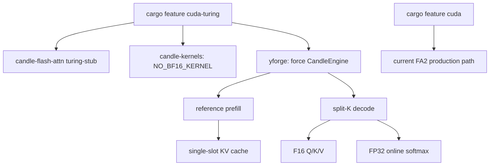

# Plan: быстрый режим RTX 20 (Turing)

**Date:** 2026-10-28
**Status:** 🟡 Implemented; real Turing benchmark pending
**Priority:** P1
**Specification:** [docs/specs/2026-10-28-rtx20-turing-support.md](../specs/2026-10-28-rtx20-turing-support.md)

## Goal

Добавить отдельный сборный профиль `cuda-turing`, который запускает текущий сервер на `sm_75` с FP16 KV, split-K decode и reference prefill, не меняя FA2-путь Ampere+. Первый релиз ограничен одним слотом; MTP, GPU vision, paged/graph prefill включаются только после отдельных гейтов.

## Current state

- `candle-flash-attn` всегда линкует static cudart и компилирует 53 FA2-ядра; на `sm_75` они неисполнимы.
- `candle-kernels` для `sm_75` падает на BF16/WMMA в `src/moe.cu`; с `-DNO_BF16_KERNEL` все 20 PTX-модулей уже успешно собираются на `yttri-win` (1m19s).
- `src/kernels/flash_decode.cu` компилируется в этот набор и реализует split-K decode для GQA/head_dim=256 без FA2.
- `model_weights.rs` содержит chunked reference prefill; он активируется через `DISABLE_FLASH_PREFILL=1`.
- `model_weights.rs::forward_attn_decode_batch` и paged path жёстко вызывают FA2.
- `CandleEngine` — существующий single-slot путь; `BatchedEngine` владеет scheduler в отдельном thread и зависит от paged/batched-состояний.
- `Qwen3.6 27B` Cargo выбирает движок по архитектуре модели; на Turing нужен принудительный `CandleEngine` при сохранении обычного выбора на `sm_80+`.

## Solution architecture



## Solution

### Build and feature gating

#### Files:
- [x] `engine/candle-flash-attn/Cargo.toml` — feature `turing-stub`.
- [x] `engine/candle-flash-attn/build.rs` — no-op build under stub; preserve FA2 guard for accidental `sm_75` non-stub builds.
- [x] `engine/candle-flash-attn/src/ffi.rs` — host stub for FFI symbol under `turing-stub`; production extern remains unchanged.
- [x] `engine/candle-kernels/build.rs` — add `NO_BF16_KERNEL` when compute capability is below 80.
- [x] `engine/qwen35-batch/Cargo.toml` — feature `turing`, which enables `cuda` and `candle-flash-attn/turing-stub`.
- [x] `Cargo.toml` — server feature `cuda-turing = ["cuda", "qwen35-batch/turing"]`.
- [x] `scripts/build_linux.sh` — explicit `cuda-turing` path and static-cudart-free check.
- [x] `scripts/windows/build_windows.bat` — optional Turing build mode controlled by `YTTRI_TURING=1`.

#### Contracts:

| Build | CUDA feature | FA2 | Intended cards |
|---|---|---|---|
| Existing | `cuda` | yes | Ampere/Ada/Blackwell |
| New | `cuda-turing` | stub | Turing `sm_75` |

### Attention runtime

#### Files:
- [x] `engine/qwen35-batch/src/real/model_weights.rs` — under `feature="turing"` route prefill to reference path and single-token decode to existing `dispatch_flash_decode`.
- [x] `engine/qwen35-batch/src/real/flash_decode_cuda.rs` — validate shapes/dtypes and expose a reusable decode wrapper for turing.
- [x] `engine/qwen35-batch/src/real/paged_attn.rs` — compile, but reject turing use before launch; Turing profile never initializes paged pool.
- [x] `engine/qwen35-batch/src/real/mtp.rs` — gate registration/use on non-turing builds; server rejects `MTP=1`.
- [x] `engine/qwen35-batch/src/real/vision.rs` — server rejects GPU-vision for turing in first release.

#### Runtime selection:

```pseudo
if feature cuda-turing {
    BatchEngine disabled
    CandleEngine enabled
    FLASH_ATTN forced off
    PGRAPH forced off
    KV_POOL_Q8 forced off
    MTP rejected
    GPU vision rejected
    attention = Turing(F16 MMA where available; FP32 softmax)
}
```

P0 uses `CandleEngine`, so duplicate slots serialize. True batching is P1 and follows only after single-slot parity/performance pass.

### Server and diagnostics

#### Files:
- [x] `src/main.rs` — select `CandleEngine` under `cuda-turing`; log backend, compute capability and disabled features.
- [x] `src/config.rs` — reject incompatible `MTP=1`, `FLASH_ATTN=1`, `PGRAPH=on`, `KV_POOL_Q8=1` under turing with explicit messages or forced documented values.
- [x] `src/engine.rs` — expose backend capability/status fields for `/v1/models` and future terminal monitor.
- [x] `README.md` — Turing build/run commands and hardware/model limits.

#### Status shape:

```pseudo
TuringRuntimeStatus {
    compute_capability: "7.5",
    attention_backend: "split_k_f16_f32_softmax",
    prefill_backend: "reference",
    paged_prefill: false,
    cuda_graphs: false,
    mtp: false,
    vision_gpu: false,
}
```

## Implementation phases

### Phase 1: Build and feature split (estimate: 4 h)
- [x] Add `turing-stub` to `candle-flash-attn` and prove its build emits no FA2 kernels or static cudart link.
- [x] Add `NO_BF16_KERNEL` selection to `candle-kernels` based on compute capability.
- [x] Add `qwen35-batch/turing` and server `cuda-turing` features.
- [x] Add build-script switches for Windows and Linux.
- **Independent check:** on `yttri-win`, build `candle-kernels` and the server with `CUDA_COMPUTE_CAP=75`; verify no FA2 library is compiled and no `cudart_static` is required for the Turing profile.

### Phase 2: Single-slot correctness path (estimate: 8 h)
- [x] Gate FA2 prefill behind non-turing and route Turing to chunked reference prefill.
- [x] Route Turing single-token decode to `flash_decode_partial/combine`.
- [x] Reject paged/graph/MTP/GPU-vision entry points before any invalid launch.
- [x] Force `CandleEngine` in server startup under `cuda-turing`.
- **Independent check:** run `yforge --features cuda-turing` on `yttri-win` RTX 3060 with a Turing emulation branch; complete 4 generations at 8K and 32K without NaN or state loss.

### Phase 3: Numeric gates (estimate: 6 h)
- [ ] Add attention tests for KV 256/2048/8192/32768 and GQA groups 1/6.
- [ ] Compare split-K output to FP32 reference at each attention layer.
- [ ] Compare end-to-end top-1/logits against the existing FA2 path on `yttri-win`.
- [ ] Record tolerance and generation divergence point.
- **Independent check:** `cargo test --release --features cuda-turing --package qwen35-batch turing_attn_parity` on `yttri-win`; tests are deterministic and parallel-safe.

### Phase 4: Performance and real hardware (estimate: 8 h)
- [x] Benchmark `sm_75` compile path on `yttri-win` as a functional proxy.
- [ ] Send the build artifact/run book to the RTX 2080 Ti reporter for one-slot tests.
- [ ] Measure 8K/32K decode and prefill against llama.cpp with three repeats.
- [ ] Decide whether a rented 2080 Ti run is required to close the release gate.
- **Independent check:** benchmark report with raw logs, model hash, driver/CUDA versions, VRAM and accepted numerical results.

### Phase 5: Polish and release decision (estimate: 3 h)
- [x] Update README and build examples.
- [x] Add `TURING=1` to logs and model capabilities.
- [x] Document that MTP, paged prefill and GPU vision are unavailable in v1.
- [ ] Decide separate binary vs universal build for packaging.
- **Independent check:** clean install from README on both RTX 3060 and at least one RTX 2080 Ti report.

## Traceability: Requirements → Tasks

| Requirement | Phase | Tasks |
|-------------|-------|-------|
| FR-001 | 1 | Feature split, sm75 build, BF16 guard |
| FR-002 | 1, 2 | Existing `cuda` feature remains unchanged; regression checks |
| FR-003 | 2, 3 | Split-K F16 decode with FP32 softmax; numeric parity |
| FR-004 | 2, 3 | GQA/head_dim 256/32K tests |
| FR-005 | 2 | Reference prefill route |
| FR-006 | 2, 5 | Startup logs and runtime capabilities |
| FR-007 | 2 | Reject paged/MTP/GPU vision |
| FR-010 | deferred | Separate true-batching phase after v1 |
| FR-011 | 2 | Existing split-K kernels |
| FR-012 | 3 | Attention parity tests |
| FR-013 | 4 | RTX 2080 Ti benchmark |
| FR-014 | deferred | Turing MTP after parity/perf gate |

## Complexity & principle deviations

| Deviation | Principle / simpler alternative | Why justified |
|-----------|--------------------------------|---------------|
| New `cuda-turing` build profile | A single build for every GPU is simpler operationally | FA2 cannot execute on Turing; compiling it still requires static CUDA SDK components and wastes ~50 minutes |
| Reference prefill in v1 | llama.cpp/Strata-style prompt MMA would be faster | Correctness-first increment; decode is the dominant interactive cost and reference prefill is already tested |
| Feature-based backend selection | Runtime dispatch from one universal binary | Cargo features avoid shipping incompatible FA2/stub code in the same Turing artifact and keep Ampere defaults untouched |

## Risks and mitigations

| Risk | Likelihood | Impact | Mitigation |
|------|------------|--------|------------|
| Split-K numerical drift before 2K KV | Medium | High | Layer-level FP32 reference gate; block release if top-1 diverges |
| No access to RTX 2080 Ti | High | Medium | Compile `sm_75` on yttri-win, test behavior on RTX 3060, use reporter for hardware; rent only after candidate exists |
| Reference prefill is too slow | High | Medium | Measure separately; add Turing MMA prefill only after v1 gates |
| Feature split leaks stub FA2 call | Medium | High | Compile-time feature gates plus runtime rejection tests; no silent stub output |
| 11 GB VRAM cannot hold chosen 27B model plus KV | High | High | Auto-select smaller model/context or fail before load; document tested model matrix |
| Current server has no terminal status feed | High | Low | Implement terminal monitor and `/v1/status` as a separate feature after Turing backend reports its capabilities |

## Dependencies

### Packages / Libraries
- No new runtime dependency for Turing profile.
- Existing `cudarc`, `candle-kernels`, and split-K kernels are reused.
- Numeric reference reuses current Candle tensor ops.

### Related tasks
- Terminal monitor: separate plan in `Qwen3.6 27B`; it must consume the Turing capability fields added here.

## Deferred questions

| Question | Why deferred | When the answer is needed | Who decides |
|----------|--------------|---------------------------|-------------|
| Universal fat binary vs separate Turing artifact | Depends on compile time, binary size and installer behavior | Before release packaging | Architect/release owner |
| Official 11 GB RTX 2080 Ti model/context limits | Requires real VRAM measurements | After first 2080 Ti artifact | Product owner |
| True batched decode for Turing | Single-slot path must pass parity and speed first | Before FR-010 | Architect |
| Turing MTP | Requires multi-token attention parity and speed data | After FR-013 | Architect |

## Plan decisions

| # | Question | Decision | Date |
|---|----------|----------|------|
| PD-001 | Как отделить Turing от FA2 без внешнего сервиса? | Additive Cargo feature `cuda-turing`; production `cuda` remains unchanged. | 2026-10-28 |
| PD-002 | Какой первый runtime path? | `CandleEngine`, single slot, reference prefill, split-K decode. | 2026-10-28 |
| PD-003 | Что делать с FA2-кодом в Turing artifact? | Build an explicit stub that cannot link kernels; runtime paths that need FA2 are rejected. | 2026-10-28 |
| PD-004 | Как обеспечить сборку Candle для sm75? | Define `NO_BF16_KERNEL` only for pre-Ampere builds; verified on yttri-win. | 2026-10-28 |
| PD-005 | Когда арендовать RTX 2080 Ti? | Only after sm75 compile and sm86 proxy run pass; first use reporter hardware if available. | 2026-10-28 |

## Tech Debt

| # | Description | Phase | Priority |
|---|-------------|-------|----------|
| TD-001 | Reference prefill is expected to trail FA2/llama.cpp on long prompts | 2 | Medium |
| TD-002 | Separate binary profile requires installer selection by compute capability | 5 | Medium |
