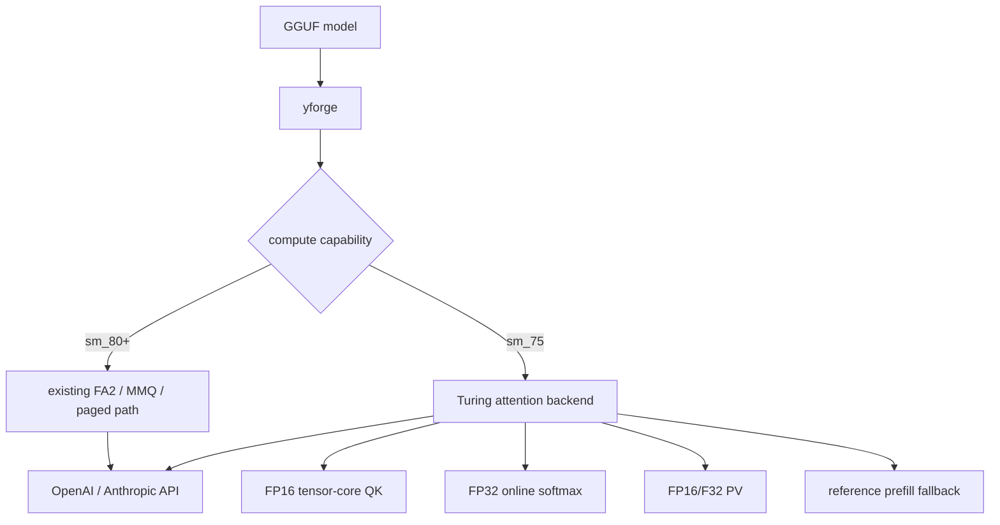

# Specification: быстрый режим RTX 20 (Turing)

**Date:** 2026-10-28  
**Priority:** P1  
**Type:** Extension

## 1. Problem

Текущий CUDA-путь рассчитан на FlashAttention-2 и BF16/WMMA. FA2-ядра требуют Ampere (`sm_80`) или новее, а специализированные BF16-инстансы `candle-kernels` не собираются для Turing (`sm_75`). Поэтому пользователь с RTX 2080 Ti получает ошибку сборки либо сборку с неисполняемым attention-путём. Обычный reference-attention технически возможен, но его производительность не проверена и он не является полноценным пользовательским режимом.

DACAN подтверждает, что Turing-инференс возможен, но его engine закрыт. Открытая Strata содержит MIT-ядра FP16 MMA и FP32 decode-attention, однако её квантование не считается эталонным и не должно использоваться. Нам нужен собственный Turing-путь на существующих GGUF-весах.

## 2. Goal

Добавить в тот же `yforge` режим для RTX 20, который собирается и запускается на `sm_75`, использует быстрый attention на FP16 Tensor Cores с FP32 softmax и не меняет текущий производственный путь `sm_80+`. Один и тот же пользовательский сервер, API и формат GGUF должны работать без внешнего inference-сервиса.

## 3. Current state

- `engine/candle-flash-attn/build.rs` сейчас отклоняет `sm_75`; это защищает от ложной поддержки, но не даёт пользователю собрать проект.
- `engine/candle-kernels/src/moe.cu` содержит BF16/WMMA-инстансы, которые CUDA 13 не компилирует для `sm_75`.
- `engine/candle-kernels/src/flash_decode.cu` уже содержит split-K decode-attention на F16/F32 без FA2; он компилируется для `sm_75` при исключении BF16-инстансов.
- `engine/qwen35-batch/src/real/model_weights.rs` использует FA2 в prefill и batched decode.
- `engine/qwen35-batch/src/real/paged_attn.rs` и paged/graph-prefill требуют FA2.
- Reference-attention уже существует в `model_weights.rs`, `mtp.rs` и служит независимым эталоном.
- `Qwen3.6 27B` выбирает `BatchedEngine` для Qwen35-моделей; `CandleEngine` остаётся одиночным fallback-путём.

## 4. User scenarios

### Scenario 1: Сборка и запуск на RTX 2080 Ti (P0)

**As** владелец RTX 2080 Ti, **I want** собрать и запустить `yforge` без внешнего сервиса, **so that** использовать поддерживаемую GGUF-модель на своей карте.

**Steps:**
1. Пользователь собирает отдельный Turing-профиль проекта.
2. Сервер определяет `sm_75` и включает совместимый attention-путь.
3. Пользователь запускает модель с одним слотом и получает корректную генерацию.

**Acceptance criteria (Given / When / Then):**
- [ ] Given CUDA Toolkit с `sm_75`, when выполняется сборка Turing-профиля, then FA2/BF16-ядра не компилируются и сборка завершается успешно.
- [ ] Given RTX 2080 Ti, when сервер загружает модель, then в логе указан режим `turing`, а не ошибка `FlashAttention requires sm80-sm90`.
- [ ] Given модель помещается в доступную VRAM/RAM по текущим правилам, when отправлен chat-запрос, then ответ корректен и сервер не завершает процесс.
- [ ] Given `sm_80+`, when используется обычный CUDA-профиль, then поведение и ядра не меняются.

### Scenario 2: Длинный контекст и повторная генерация (P1)

**As** пользователь RTX 20, **I want** работать на контексте до 32K без деградации состояния, **so that** Turing-режим был пригоден для реальных задач, а не только smoke-теста.

**Acceptance criteria:**
- [ ] Given контекст 32K, when выполняются четыре последовательные генерации не менее 2K токенов, then нет NaN, падения, зависания и потери KV после границы 2048.
- [ ] Given одинаковые seed/параметры и один процесс, when повторяется запрос, then топ-1 токены совпадают с reference-attention в заданном тестовом наборе.
- [ ] Given несколько одновременных запросов в пределах VRAM, when Turing-режим получает batch, then каждый слот сохраняет изолированное состояние.

### Scenario 3: Прозрачный fallback и диагностика (P1)

**As** пользователь или разработчик, **I want** видеть, какой путь выбран и почему, **so that** ошибки производительности не маскировались молчаливым fallback.

**Acceptance criteria:**
- [ ] Given неподдерживаемую геометрию attention, when запускается модель, then сервер явно сообщает причину отказа или выбранного reference-пути.
- [ ] Given Turing-режим, when сервер стартует, then в статусе указаны compute capability, attention backend, KV backend и отключённые функции.
- [ ] Given отсутствие поддержки MTP/vision/paged path, when запрашивается отключённая функция, then возвращается понятная ошибка или документированный fallback без повреждения состояния.

## 5. Functional requirements

### Must Have (P0)

- **FR-001:** Turing-профиль собирается для `sm_75` без FA2 и без BF16/WMMA-инстансов, несовместимых с Turing.
- **FR-002:** Обычный CUDA-профиль `sm_80+` сохраняет текущие FA2, MMQ, paged-decode и CUDA-graph пути.
- **FR-003:** На `sm_75` attention использует F16 Tensor Core-операции там, где они поддерживаются, и FP32 softmax/accumulation в смысле численной устойчивости.
- **FR-004:** Decode-attention поддерживает GQA, `head_dim=256`, KV длиной не менее 32K и причинную маску.
- **FR-005:** Prefill использует рабочий совместимый путь; допустим reference/matmul fallback, но он должен измеряться отдельно от decode.
- **FR-006:** Сервер автоматически публикует выбранный backend и ограничения Turing-режима.
- **FR-007:** MTP, GPU-vision и paged/graph-prefill не включаются на `sm_75` без отдельной проверенной реализации.

### Should Have (P1)

- **FR-010:** Turing-режим поддерживает true batched decode до числа слотов, помещающегося в память.
- **FR-011:** Для decode реализован split-KV или эквивалентный параллелизм по контексту.
- **FR-012:** Есть parity-тест attention-ядра против FP32 reference для F16, GQA и KV 256/2048/8192/32768.
- **FR-013:** Есть benchmark одного и того же GGUF против llama.cpp на RTX 2080 Ti.
- **FR-014:** MTP для Turing добавляется только после отдельного parity- и benchmark-гейта.

### Nice to Have (P2)

- **FR-020:** Оптимизация prefill для Turing с FP16 MMA/FP32-accumulation.
- **FR-021:** Turing-специфичный вариант paged-decode без CUDA graph.
- **FR-022:** Поддержка Turing GPU-vision.

## 6. Non-functional requirements

- **Performance:** На RTX 2080 Ti, одном слоте, 8K контексте и одинаковом GGUF decode должен быть не ниже 0.85× llama.cpp; prefill — не ниже 0.65× llama.cpp. Цель подтверждается не менее тремя повторами на стабильной машине.
- **Correctness:** TF32/FP16 не используются для softmax. Attention-выход проверяется по FP32 reference; допуск задаётся отдельно для ядра и для end-to-end топ-1/loss.
- **Reliability:** 4 генерации по 2K токенов при 32K контексте без падения, NaN, OOM-утечки и зависания.
- **Compatibility:** Windows и Linux x64, CUDA 12.4+ и CUDA 13.x на `sm_75`; RTX 20 — минимум `sm_75`.
- **Data:** Новые квантованные форматы и перепаковка весов не требуются; вход остаётся обычным GGUF.
- **Security:** Выбор backend не ослабляет проверки путей, API-аутентификацию и ограничения памяти.

## 7. Data model

Новых пользовательских сущностей нет. Runtime добавляет концептуальный `TuringCapabilities`:

```text
TuringCapabilities
  - compute_capability: 7.5
  - attention_backend: fp16_mma_fp32_softmax | reference
  - max_verified_context: integer
  - paged_prefill: false
  - cuda_graphs: false
  - mtp: false until parity gate
  - vision_gpu: false until parity gate
```

## 8. User interface

Отдельного UI не требуется. Режим и ограничения выводятся в startup-логе и доступны через существующие статусные API. Терминальный монитор `yttri-forge` является отдельной задачей и должен показывать этот backend.

## 9. Architecture (overview)



## 10. Out of scope

- Внешний сервис, sidecar или зависимость от DACAN.
- Использование DACAN/Strata-квантов, весов или численных результатов как эталона.
- Turing-поддержка GTX 10/Volta или устройств ниже `sm_75`.
- Одновременное включение CUDA graph prefill и paged FA2 на Turing.
- Обещание MTP, vision и paged-decode в первом релизе.
- Изменение текущих оптимизаций и дефолтов `sm_80+`.

## 11. Deferred questions

| Question | Why deferred | When the answer is needed | Who decides |
|----------|--------------|---------------------------|-------------|
| Нужен ли отдельный Turing-бинарник или универсальный fat build с обоими backend | Цена compile time и размера binaries зависит от реализации | Перед упаковкой релиза | Архитектор релиза |
| Поддерживать ли официально 11 GB RTX 2080 Ti при 27B Q2 или ограничиться моделями, помещающимися в память | Зависит от результатов VRAM benchmark | После первого Turing прогона | Product owner |

## 12. Spec decisions

| # | Question | Decision | Date |
|---|----------|----------|------|
| D-001 | Делать отдельный сервис? | Нет. Режим работает внутри `yforge`. | 2026-10-28 |
| D-002 | Использовать квантование DACAN/Strata? | Нет. Остаёмся на текущих GGUF-весах. | 2026-10-28 |
| D-003 | Можно ли менять `sm_80+` path ради Turing? | Нет. Существующий FA2-путь сохраняется без функциональных изменений. | 2026-10-28 |
| D-004 | Использовать BF16 на Turing? | Нет. Turing-путь использует F16 Tensor Cores и FP32 softmax/accumulation. | 2026-10-28 |
| D-005 | Какие функции отключить в первом релизе? | Paged/graph prefill, MTP и GPU vision; включать только после отдельных гейтов. | 2026-10-28 |
| D-006 | Нужна ли итерация без покупки 2080 Ti? | Да. Сборка и sm_75 compile-check возможны на `yttri-win`; железная проверка нужна перед объявлением поддержки. | 2026-10-28 |
| D-007 | Использовать ли исходники DACAN? | Нет. DACAN engine закрыт; допустимы MIT-идеи и исходники Strata/llama.cpp без переноса квантования. | 2026-10-28 |

## 13. Success criteria

- [ ] Turing-профиль проходит сборку для `sm_75` и запускает поддерживаемую модель на RTX 2080 Ti.
- [ ] End-to-end ответы стабильны и проходят parity/reference gates.
- [ ] Decode и prefill достигают согласованных относительных порогов против llama.cpp.
- [ ] `sm_80+` regression suite и замеры остаются в пределах текущего шума.
- [ ] В логе и статусе однозначно видно, что включён Turing-режим и какие функции ограничены.
